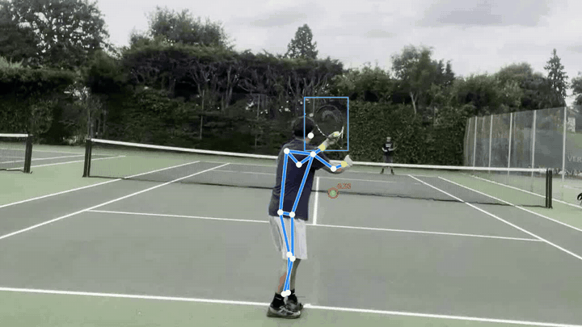
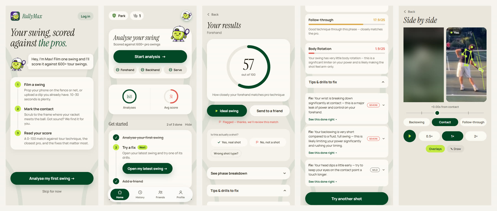
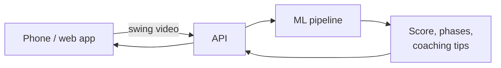
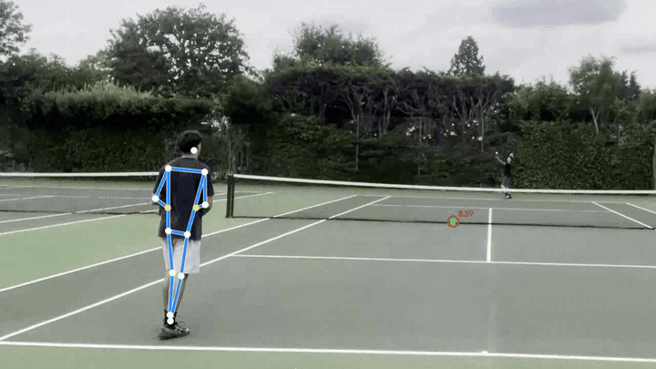
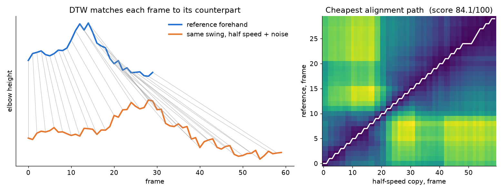

# RallyMax — AI tennis swing analysis

[](https://github.com/JP14939/rallymax/actions/workflows/test.yml)

Film a swing on your phone, and RallyMax tells you how close it is to a professional's: a 0–100 similarity score, a breakdown by phase of the swing, and coaching tips. It runs on iOS, Android and the web.

<p align="center">
  
  <br><sub>A serve with pose, racket and ball tracking drawn on top.</sub>
</p>

I built RallyMax end to end: the app, the backend, the deployment and the ML pipeline. This repo is a write-up of the project. The product code, models and data are proprietary and live in a private repo, apart from one production file shown below.

## The app

<p align="center"></p>
<p align="center"><sub>Welcome · home · a 57/100 forehand with its phase breakdown · coaching tips ranked by severity · side-by-side playback against an ideal swing (blurred here).</sub></p>

## How it works, at a high level



The ML pipeline combines pose estimation, object detection for the ball and racket, and audio, then compares the player's swing against a database of about 650 professional swings using Dynamic Time Warping (DTW). DTW lines two swings up phase by phase even when one is faster than the other.

<p align="center"></p>

## Results

- **Contact detection:** finds the moment the racket hits the ball to within ±3 frames on 89% of clips, against about 9 frames off for the first approach.
- **Pro database:** about 650 professional forehands, backhands and serves.
- **Debugging by distribution:** a coordinate-convention mismatch made pro swings score about 32/100 against themselves. Plotting the distribution, not the median, exposed it; after the fix they score about 81. Lesson: look at the distribution before deciding a metric is just noisy.

## Production code: swing comparison

[`production/trajectory_compare.py`](production/trajectory_compare.py) is the live app's code (only comments that pointed at private files were reworded). It answers the core question: how far is this swing from that pro's? Every upload runs it against each eligible pro in the database, and the closest one becomes the match.

- `_frame_dist` turns two poses (one frame each) into one number: the average distance between matching joints, in body-size units.
- `dtw_distance` runs DTW over whole swings with that cost, `O(n·m)`, and divides by the longer swing's length so short and long clips are comparable.
- The constants record two bugs I measured and fixed: monocular depth (`z`) swamped the metric, so it's switched off; and a trajectory missing its hitting wrist looked close to everything (one clip was the top match for 7 of 18 pro serves), so a joint missing on one side now costs a fixed penalty.

The app turns the distance into the 0–100 score with `100 · e^(−distance / 0.4)`.

## Toy demo

<p align="center"></p>

`demo/dtw_demo.py` is the textbook DTW algorithm on made-up curves, to show the idea. It is not RallyMax's pipeline.

```bash
python demo/dtw_demo.py
pytest
```

```
DTW distance from the reference swing (lower = more similar)

  same swing                 0.000
  same swing at half speed   0.007
  same swing with noise      0.025
  a different swing          0.345
```

**Stack:** Python, MediaPipe, YOLO, React Native (Expo), Node.js, Docker, GitHub Actions.

**Next:** I've recently added two developers to the project to speed up development.

© Jack Price. All rights reserved. · [LinkedIn](https://www.linkedin.com/in/jack-price-swe/) · jack.p14370@gmail.com
